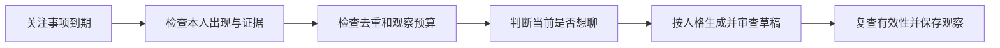

# 关注事项主动决策观察

日期：2026-10-26。状态：已实现，只观察，不发送。

## 功能与使用

已保存的关注事项到期、本人近期出现时，机器人评估是否想聊；合适时生成一两句符合当前人格的候选表达。观察结果保存到本地，供开发者核对时机和台词。此功能没有发送接口，也不进入聊天发送队列。

沿用已启用的允许群、addressed 采集范围和 `EVENT_FOLLOWUP_MODE=observe`。普通发言只提供短期语境和本人出现信息，不因此扩大长期记忆采集范围。长期事件聊天召回继续可用，既有普通聊天和主动参与策略保持独立。

查看最近 20 条历史观察：

```sh
pnpm observe:events
```

该命令只读数据库，不请求模型、不连接 QQ。报告使用群和用户别名，显示事件摘要、观察时间、触发窗口、保存的态度倾向、结果、原因和可用草稿。正文可能包含用户自己的资料，只在本地查看。`memoryStillCurrent` 仅检查事件是否仍有效，不表示当前仍适合发言。

## 处理流程



前置检查继续使用事件版本、清空版本、触发窗口和本人最近 15 分钟的出现信息。缺失有效证据、用户关闭主动关心、事件失效或不在允许群时，不进入模型评估。当前群聊没有可用的本人近期发言，或机器人最近 5 分钟刚发过言，记录跳过。

评估分三个独立请求：时机判断、人格表达、草稿审查。跳过时只运行第一个；生成草稿最多三个请求，每个最多 5 秒，不自动重试。所有资料使用临时别名，模型没有工具。明确呼叫仍可取消这条后台任务，为正常聊天让出并发名额。

## 人格与参考文本

| 文件 | 责任 |
|---|---|
| `src/events/runtime.ts` | 通用资格检查、任务取消、版本复查、调用观察接口；没有主题或人格分支 |
| `src/events/store.ts` | 事务认领、持久去重、观察预算、结果保存与清空 |
| `src/events/initiative.ts` | 应用层的时机判断、人格方案和独立草稿审查 |
| `config/event-memory/initiative.md` | 通用交流判断、输出协议、态度倾向与资料边界 |
| `config/event-memory/initiative-references.md` | 具体主题的公开交流范围、表达示例与不能推断的事实 |
| `config/event-memory/references/` | 事件理解参考，继续供主题理解使用 |

模块人格模式复用 `resolveExpression` 和 `chatSystemPrompt`。当前语境决定表达模式，明确停止调侃和已有调侃偏好继续生效。关注事项创建时保存的 upbeat、wry、gentle 倾向可影响期待、自嘲或平和关心；重启和重复检查不会重新抽取，倾向不能改变事实或覆盖当前严肃语境。

原文只支持计划时不能声称已经完成；只有区间结束不能断言恢复工作。具体例子和敏感主题的交流判断均保存在参考文本中，新增主题不用修改引擎。

## 数据与结果

新增 `attention_observations` 表，沿用事件库版本 2，建表可重复执行，旧事件和关注事项不需要转换。每条记录包含群与用户范围、关注事项 ID、事件版本、清空版本、开始与结束时间、触发窗口、态度倾向、群聊版本及结果。

| 结果 | 含义 |
|---|---|
| drafted | 候选台词通过本轮模型审查，仅为历史观察样本 |
| skipped | 当前不适合聊，或缺少语境、机器人刚发过言 |
| rejected | 草稿审查发现无依据、公开追问不妥或不符合人设；不保留被拒台词 |
| unavailable | 某个模型阶段失败或返回不合法资料；原因标明 decision、expression 或 review 阶段 |
| interrupted | 前台抢占、断开或进程中断；不重试 |
| invalidated | 期间记忆、偏好、触发条件或群聊版本发生变化；丢弃草稿 |

同一关注事项、同一事件版本只认领一次，跳过、失败和重启也不重复请求。每群滚动一小时最多 6 次认领，每群每人每个上海自然日最多一次；预算用尽时暂不认领。每次调度最多评估一项。它们是观察成本限制，不能当作未来的发送预算。

认领写入数据库后再请求模型，重启将未完成记录标为 interrupted。完成前重新检查来源证据、事件版本、清空版本、窗口、本人出现、主动偏好和群聊版本。清空本人记忆同时删除观察记录，晚到结果只能更新已有行，不能恢复已删除内容。

观察记录最多保留 30 天，关联事件到期或被删除时提前清理。事件修正前已经完成的结果可作为历史观察保留；报告不能把它视为当前候选。

## 验证与限制

新增 11 项测试覆盖到期与出现条件、证据隔离、禁止主动联系、预算、重启去重、前台取消、清空、更正和群聊变化、各阶段资料引用、独立审查、人格偏好、聊天调度接入及只读报告。全量 232 项测试、类型检查和差异空白检查通过。离线回放现在包含一次草稿观察，重复 tick 不重复评估，`sendCapability=false`。

真实模型使用独立内存数据库运行六组匿名样本，没有写入真实记忆或发送消息。早期样本曾主动问及复查结果，已补充公开交流参考并增加独立审查。最终一轮中：明确返岗样本生成草稿，故障排查与医疗隐私样本跳过；另有语境突兀的跳过和无依据草稿的拒绝。原始结果保存在本机忽略目录 `data/runtime/event-initiative-smoke-results.json`。

不同轮次存在判断波动，也出现过协议不合法和保守拒绝。程序校验和独立模型审查不能保证语义正确；少量样本不构成发送验收。当前不重试同一机会，也不在语境变化后重新评估，因此可能错过后续更自然的交流时机。

已仅重启 Node bot。启动日志确认 `initiative=observe`、`send=false`、`recall=enabled`，采集范围仍为一个允许群的 addressed，人格保持 modular；只读 OneBot 检查确认在线且服务正常。新观察表已创建，加载检查时尚无真实观察记录，后续由正常群聊自然触发。文档已检查标题、术语、敏感信息和数据来源。
