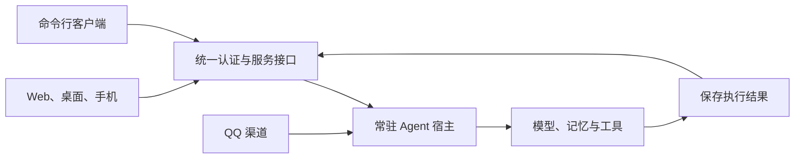

# Web、CLI 与桌面手机客户端设计

日期：2026-10-27。状态：阶段 B 已实现常驻服务和正式 API 首版，见[实施记录](MULTI-CLIENT-PHASE-B.md)。阶段 A 的 Web、macOS 和 iOS 模拟器构建及连接已验证，Android 暂停。面向本项目的产品与开发维护者。

当前实施方向：后续以 CLI 和 Web 为主，桌面端、iOS、Android 暂停迭代。保留本轮原生工程与验证记录，恢复 App 开发需另行确定；原生端未完成项不阻塞常驻服务、CLI 和 Web 的后续工作。

## 1. 目标与部署约定

Agent 常驻一台主机，当前部署在本机，未来迁往云端。Web、CLI（命令行客户端）、桌面 App 和手机 App 连接同一个服务，共享会话和执行状态。所有界面都依赖在线服务，不实现离线工作。

本机与云端使用同一套服务接口和数据模型。客户端不运行模型、QQ 连接或后台记忆任务，不直接打开 SQLite，也不保存模型提供商密钥。关闭浏览器、退出 App 或终端断开不会停止 Agent。

首版以一个服务拥有者为使用主体，保留 QQ 群聊和私聊中的联系人隔离。拥有服务的控制权，不自动意味着可以在界面中读取其他联系人的全部私聊资料。

## 2. 总体方案



图中的客户端访问同一个会话。QQ 是独立的外部渠道；Web、桌面、手机和 CLI 则是第一方工作台的不同设备入口，不必分别创建四套渠道适配器。

建议使用 HTTP API 发送命令，SSE（服务端持续推送事件的连接）同步状态。服务持有执行任务，连接只负责展示结果。首版无需同时维护一套客户端 WebSocket 协议；现有 QQ WebSocket 连接继续保留。

## 3. 技术选择

| 部分 | 建议 | 理由与边界 |
| --- | --- | --- |
| Agent 服务 | 保留 Node.js / TypeScript，HTTP 层采用 Fastify | 复用当前核心与 SQLite，不移植到 Rust；新增路由、认证、校验和事件推送 |
| Web 与 App 界面 | React + TypeScript + Vite | 一套响应式界面适配浏览器、桌面和手机尺寸 |
| 桌面与手机容器 | Tauri 2 | 复用 Web 静态构建；将界面打包成可安装应用，负责系统集成和凭据存储 |
| CLI | TypeScript，独立命令解析和输出层 | 通过共享 SDK（客户端调用库）调 API；不读取核心数据库 |
| 协议与客户端库 | 独立 contracts 与 client 包 | 共享请求校验结构、响应类型、错误码和事件类型，不依赖服务端模块 |
| 数据与后台作业 | 服务端 SQLite + 单实例宿主 | 沿用现有数据，后台作业不依赖任何界面连接 |

Tauri 官方支持桌面以及 Android、iOS，并提供 Vite 集成说明，因此适合复用本项目以聊天、记忆和状态为主的界面。原生插件的能力仍须逐平台验证，不能把界面复用当作全部系统能力自动通用。[Tauri 平台说明](https://v2.tauri.app/)、[Vite 集成](https://v2.tauri.app/start/frontend/vite/)。

Fastify 的 TypeScript 和请求 schema 支持可用于服务接口；实施时应以共享的运行时校验结构约束输入，不能只依赖 TypeScript 类型。[Fastify 类型说明](https://fastify.dev/docs/latest/Reference/TypeScript/)。

### 3.1 备选方案

| 路线 | 本项目取舍 |
| --- | --- |
| Tauri 同时构建桌面与手机 | 推荐先做小型构建验证，共用界面与一种容器技术 |
| 桌面 Tauri、手机 Capacitor | 如果手机端关键原生能力验证不通过，再考虑这一替代；仍保留同一套 Web 界面 |
| Expo / React Native | 更适合原生交互要求成为主要约束时重新评估；首版不另建一套组件体系 |
| Electron 桌面加另一套手机方案 | 当前没有客户端运行 Node 的需求，不选作首版 |

Capacitor 官方以 Web 为基础提供 Android、iOS 容器；Expo 也支持 Web。这些能力提供备选路径，不作为同时引入两套前端框架的理由。[Capacitor](https://capacitorjs.com/docs)、[Expo Web](https://docs.expo.dev/workflow/web/)。

## 4. 用户界面

### 4.1 页面与能力

| 页面 | 首版内容 |
| --- | --- |
| 对话 | 会话列表、文字交流、执行状态、取消当前请求、历史结果；图片通过受控上传接口接入 |
| 记忆 | 本人事实与来源窗口、当前或历史状态、证据片段、版本；查看和清除明确范围的记录 |
| 活动 | 已接受、排队、运行、完成、失败、取消的执行记录；展示工具结果和简短失败原因 |
| 设置 | 服务连接、设备授权、QQ 连接状态、能力开关、模型配置是否完整 |

桌面采用左侧导航、中间对话、可展开详情栏。手机采用底部导航，对话列表和记忆详情分别进入页面。主界面服务个人交流与办事，原始日志、完整提示词和内部判断结构不放在普通对话流中。

首版没有高风险执行工具，不单独铺设空的审批中心。以后新增需要确认的工具时，在活动记录和当前对话中展示明确的待确认卡片，再扩展审批接口。

### 4.2 状态展示

服务连接、Agent 是否接受新请求、QQ 是否在线、模型是否已配置分别展示。进程存在不等于 QQ 在线，也不等于模型调用成功。模型连通性检查由用户主动发起，避免状态轮询反复消耗模型请求。

现有文字生成关闭了模型流式输出，首版先推送排队、执行、取消及最终结果。后续若增加逐字输出，必须标明尚未提交的草稿，并重新评估发送前检查与用户已看到内容之间的关系。

### 4.3 在线使用

断线时保留编辑中的输入可选，但不自动排队提交任务。重新连接先取得服务快照，再补读遗漏事件。用户切换设备后可以继续同一会话，不重建 Agent。

手机进入后台可能中断连接；回到前台后按事件位置恢复。后台消息推送需另外接入平台推送服务，首版不承诺后台长连接一直存活，也不把持续运行 Agent 的责任交给手机。

## 5. 命令行指令集

以下均为拟议命令，当前仓库尚未提供 `agent` 可执行文件。

| 命令 | 用途 |
| --- | --- |
| `agent connect <service-url>` | 保存目标服务地址并发起设备配对 |
| `agent profiles list` / `agent profiles use <name>` | 查看、切换本机或云端连接配置 |
| `agent logout` | 撤销当前设备凭据并清除本地登录状态 |
| `agent status` | 查看服务、Agent、QQ 和模型配置的分项状态 |
| `agent doctor --probe model` | 明确发起一次模型连通性检查 |
| `agent chat` | 进入交互对话；可选择已有会话 |
| `agent ask "问题" --conversation <id>` | 在指定会话提交一次请求 |
| `agent conversations list` | 列出当前身份有权访问的会话 |
| `agent runs get <id>` / `agent runs watch <id>` | 读取、持续观察一次执行 |
| `agent runs cancel <id>` | 取消本人有权限取消的执行 |
| `agent memory list` / `agent memory show <id>` | 查看本人可见记忆及其来源 |
| `agent memory forget <id>` | 清除指定记录；先显示影响范围，自动化可显式确认 |
| `agent channels list` / `agent channels status qq` | 查看已配置渠道及分项状态 |
| `agent channels reconnect qq` | 经服务端权限检查后重连 QQ 适配器 |
| `agent runtime pause` / `agent runtime resume` | 暂停接收新请求、恢复接收；暂停不伪造已运行任务的完成状态 |

常用查询支持 `--json`；持续观察支持 `--jsonl`，每行一个事件。正常结果写 stdout，诊断写 stderr。退出码拟定为：0 成功、1 执行失败、2 参数错误、3 未认证或无权限、4 服务不可达、5 请求被取消。

`agent ask`、`agent chat` 默认等到本次执行结束。Ctrl+C 只结束本地观察；取消服务端任务通过 `agent runs cancel` 明确发起。网络错误不代表远端任务未被接受，重试必须复用原请求标识。

CLI 同样是在线客户端。部署进程的启动停止由主机上的运维入口负责，拟新增 `pnpm agent:serve`。现有 `bot:start` 等命令仅作为迁移期的本机运维入口，不扩展为手机或远程客户端的进程控制接口。

## 6. 服务接口与执行模型

### 6.1 首批接口

| 接口 | 作用 |
| --- | --- |
| `GET /api/v1/me` | 当前身份、设备和允许的操作 |
| `GET /api/v1/status` | 分项健康状态，不自动探测模型 |
| `POST /api/v1/pairings` | 创建短时、单次使用的设备配对请求 |
| `POST /api/v1/pairings/<id>/approve` | 由已授权的拥有者确认设备及权限 |
| `GET /api/v1/conversations` | 当前身份可见会话 |
| `POST /api/v1/conversations` | 创建第一方工作台会话 |
| `GET /api/v1/conversations/<id>/messages` | 分页读取已保存消息 |
| `POST /api/v1/conversations/<id>/messages` | 接受消息，返回消息标识、执行标识和事件位置 |
| `GET /api/v1/runs/<id>` | 读取执行状态和已保存结果 |
| `POST /api/v1/runs/<id>/cancel` | 明确取消执行 |
| `GET /api/v1/events` | 按权限订阅并补读状态事件 |
| `GET /api/v1/memory` / `GET /api/v1/memory/<id>` | 读取本人可见的记忆投影 |
| `DELETE /api/v1/memory/<id>` | 清除授权范围内的记录及其相关投影 |
| `POST /api/v1/attachments` | 上传图片，返回归属当前用户的附件标识 |

这是一份接口范围草案。具体 schema、分页方式和错误码在服务阶段形成契约测试；读取设置只返回脱敏状态，模型密钥由主机部署配置注入，首版不提供客户端读取或修改密钥的接口。

### 6.2 一次请求的生命周期

一次执行称为 Run，表示现有一轮生成和工具调用，不意味着新增复杂任务规划器。

```text
queued → running → completed / failed / cancelled
                    └ 重启中断：interrupted
```

请求携带客户端生成的 `clientMessageId`。服务以身份、会话和该标识做事务去重；同一标识同一内容返回原执行，同一标识内容不同则拒绝。服务保存输入后返回接受结果，生成过程在服务内继续，不占住原 HTTP 请求。

服务重启后，尚未完成的执行标记为 interrupted。可查询的工具和外部发送具有不同重试规则；已确认发送不重复执行，未确认的 QQ 发送继续保持不自动重发。这里不承诺跨网络的恰好一次发送。

### 6.3 事件与重连

事件至少包含 `eventId`、`runId`、`conversationId`、类型与时间。首版需要 message.accepted、run.started、run.completed、run.failed、run.cancelled、message.committed 等事件。

事件保存后再通知客户端。按事件位置补读，过期位置返回重新同步提示；客户端用事件标识去重。鉴权和会话可见性检查在事件序列化之前完成，不能广播全部事件后让客户端自行过滤。

删除记忆、更正事实、取消执行和新消息取代旧请求，都要继续参与生成后的有效性检查。客户端看到消息前已失效的草稿，不发布为最终结果。

### 6.4 保存、送达与已读

第一方工作台的回答先通过策略检查并持久化为可查询消息，再视为该渠道提交成功。客户端是否在线不会改变已提交结果，也不会因多个设备确认而重复写记忆。

设备接收与用户已读是独立状态。QQ 则继续以协议发送确认作为实际送达依据，部分送达只记录成功的部分。工作台自身会话可以同步到多个设备，不能把同一个回答再次发回 QQ。

## 7. 身份与私聊边界

### 7.1 服务身份与渠道身份

新增服务拥有者、已授权设备、渠道身份绑定。客户端请求只能使用认证后确定的身份，不能自报 `senderId` 或 `ownerId` 来读取记忆。拥有者的浏览器会话也不自动等于某个 QQ 账号。

QQ 绑定需要本机初始化或已授权拥有者创建一次性码，再由本人在 QQ 私聊中完成验证；不接受群聊中认领账号。验证码短时有效、单次使用并限制尝试次数，绑定结果可撤销。

现有 QQ 记录仍保留原账号、群号和 `private:<账号>` 存储键。通过已验证绑定查找其旧作用域，继续保留原来源，不批量改写数据库键。其他联系人不会因拥有者绑定而并入本人的资料。

### 7.2 明确聊天类型与路由

运行时新增明确的聊天类型和渠道路由信息，例如 `kind: direct | group` 与 `channelId: console | qq`。工作台使用独立会话标识；内部路由以渠道和会话组成键，避免平台字符串碰撞。

`private:<数字>` 仅作为 QQ 旧记录的兼容形式。接入工作台前，模型环境、暖场资格、记忆可见性必须读取明确的会话元数据，不能继续从任意 `chatId` 字符串猜测。

浏览本人私聊记忆与把私聊事实用于 QQ 群回复，是两种不同权限。界面登录、切换设备、绑定 QQ 均不会变成群聊披露授权；仍需本条群消息的具体授权，筛选与生成使用同一份私聊资料。

### 7.3 认证与网络

- 本机默认仅监听回环地址，仍要求认证；初次拥有者凭据由主机初始化流程产生，不能允许网络访客抢注。
- Web 优先同源部署，使用受保护的 HttpOnly 会话 Cookie，修改操作校验来源并防止跨站请求伪造。
- CLI 和 App 使用可撤销的设备凭据。App 使用系统安全存储，CLI 优先系统凭据存储或仅本人可读的凭据文件，不写入命令历史或日志。
- 云端接入使用 HTTPS，配置明确允许的客户端来源；不依靠 CORS（跨域访问规则）代替认证，不使用 URL 查询参数传长期令牌。
- App 内嵌可信静态资源，外部链接交给系统浏览器，原生能力只开放所需权限。[Tauri 能力权限](https://v2.tauri.app/security/capabilities/)。

手机中的 localhost 指手机本身。本机开发阶段，手机应连接主机可达的受保护服务地址；未来切换到云端 HTTPS 地址，客户端协议和会话不变。

## 8. 对现有代码的具体影响

| 当前位置 | 拟调整 |
| --- | --- |
| `src/app/napcat.ts` | 提取模型、记忆、定时器与配置组装，形成统一服务启动入口；QQ 连接成为可选接入 |
| `src/runtime/agent.ts` | 将核心宿主生命周期与渠道连接生命周期分开；提供接收输入、查询执行与取消接口 |
| `src/channels/channel.ts` | 保留外部渠道能力，补路由和渠道内会话类型；工作台查询管理不塞入渠道 send 接口 |
| `src/channels/console/`（拟新增） | 接收经认证的工作台输入，持久保存回答并发布结果事件 |
| `src/runtime/conversation/` | 延续窗口、优先级、取消与发送检查，接入执行标识和明确会话元数据 |
| `src/runtime/delivery/` | 明确结果提交与设备接收的区别，保留 QQ 逐段确认，不将 UI 订阅当送达回执 |
| `src/memory/events/config.ts` | 长期记忆启用不再以必须配置数字 QQ 群白名单为前提；工作台直聊独立授权 |
| `src/memory/events/` | 用已验证身份解析旧作用域；跨身份别名召回要修改当前 ownerId 字面相等检查，并保留每个来源的删除与版本检查 |
| `src/tools/vision/` | 将 QQ 下载与文件解析移到适配端；上传使用所有者校验后的附件标识，公共层保留格式、大小和解码限制 |
| `src/cognitive/personality/persona.ts` | 人格与当前渠道环境分开，浏览器和手机会话不再被描述为 QQ 群聊 |

QQ 断连只影响 QQ 路由，不暂停工作台交流和宿主的全部后台任务。服务拥有记忆定时器，客户端连接数不会增加后台任务副本。SQLite 仍由单个服务实例管理。

新的工作台消息、执行记录、设备与事件属于独立的附加存储。现有表和 JSON 兼容规则保留；具体新增表及迁移版本在实现阶段确定，并提供旧库升级和恢复测试。

## 9. 代码组织

保留刚整理好的 `src` 领域目录。新增客户端通过 pnpm workspace 管理；以下为目标位置。阶段 A 已建立 Web、原生容器、模拟服务及共享包；阶段 B 已增加共享启动、服务入口、HTTP 层、工作台生成环境及执行存储。CLI 和业务页面尚待接入，实际结果见[阶段 B 记录](MULTI-CLIENT-PHASE-B.md)。

```text
src/
  app/service.ts           常驻进程入口
  app/bootstrap.ts         共享配置、模型和记忆组装
  app/server/              HTTP、认证、事件与接口处理
  channels/console/        第一方对话输入和结果提交
  runtime/                 现有运行时及新增执行状态
  cognitive/ memory/ tools/ shared/
apps/
  web/                     React 页面与响应式布局
  native/src-tauri/        同一 Web 构建的桌面、Android、iOS 容器
  cli/                     命令解析、交互终端和 JSON 输出
packages/
  contracts/               无 Node 依赖的协议结构、校验与错误码
  client/                  无界面依赖的 HTTP、事件订阅和重连客户端
```

客户端只依赖 contracts 与 client，不从核心目录深层导入 SQLite、进程管理或模型代码。原生能力通过很小的宿主接口提供，普通页面不直接调用操作系统 API。

## 10. 构建与发布

| 目标 | 构建产物与要求 |
| --- | --- |
| Web | Vite 静态资源，可与 API 同源部署 |
| macOS / Windows / Linux | Tauri 安装包；分别在对应平台构建与验证，签名按发布渠道准备 |
| Android | Android 原生工程与安装、分发包，需要 Android SDK 等工具链 |
| iOS | iOS 工程与签名产物，需要 macOS、Xcode 和相应签名配置 |
| CLI | 带可执行入口的 Node 包，声明所需 Node 版本 |
| Agent 服务 | Node 服务、原生依赖及数据目录，独立于客户端发布 |

一次代码复用不代表在任意主机上同时完成所有平台的签名发布。工具链与包格式以实施时的官方要求和构建验证为准。[Tauri 前置条件](https://v2.tauri.app/start/prerequisites/)、[发布说明](https://v2.tauri.app/distribute/)。

服务与客户端分别带版本号，API 使用 v1 协议。先部署兼容新旧客户端的服务，再更新客户端；不兼容接口拒绝连接并说明升级要求。

## 11. 从本机迁移到云端

迁移时暂停新请求，等待或明确中断执行，制作一致的数据库备份并保留附件和必要配置。不能只复制仍在写入的 SQLite 主文件而遗漏 WAL（SQLite 写前日志）数据。恢复后验证记录、身份和来源，再恢复访问。

旧主机与云端不能同时驱动同一 QQ 账号。明确停止原宿主后才启用云端的 QQ 连接，保留当前未确认发送不自动重发的语义。客户端更换服务地址并重新配对，不在四个终端之间同步数据库副本。

稳定的域名可减少客户端配置变化，但本机和云端各自的设备授权应明确迁移或重新签发。模型密钥与 QQ 令牌通过服务端部署配置转移，不随 Web 或 App 构建包发布。

## 12. 实施顺序与验收

| 阶段 | 交付 | 进入下一阶段的条件 |
| --- | --- | --- |
| A：客户端构建验证 | 最小 Web、macOS 与 iOS 模拟器工程，连接模拟 API；Android 暂停 | 当前范围已完成构建和前台连接验证；原生桥接与插件范围有记录 |
| B：常驻宿主与协议 | 统一启动、明确身份与会话类型、执行记录、幂等提交、认证、事件恢复 | 无界面也能运行；QQ 断连不影响工作台；客户端不能冒用他人身份 |
| C：Web 与 CLI | 对话、活动、本人记忆查询和有限管理 | Web 发请求后 CLI 可观察和取消；断线重连不重复执行；旧库测试通过 |
| D：桌面和手机界面（暂停） | 同一 Web 界面的原生容器、设备配对、前后台恢复 | 关闭界面不影响 Agent，手机恢复后取回准确结果，凭据可撤销 |
| E：云端演练 | HTTPS、部署、备份恢复、独立客户端升级 | 数据完整迁移，同一 QQ 账号没有两个活动宿主，所有客户端可以切换连接 |

A 阶段只验证构建和连接风险，不提前完成全部页面。B 与 C 是实际功能主线；全端通知、自动更新、复杂审批和多拥有者共享服务后续按需求增加。

关键回归场景：相同请求重试不重复执行；同一结果多设备订阅只记录一次；取消与完成竞态有确定结果；撤销设备后不能继续补读事件；QQ 群回复不因工作台授权扩大私聊范围；删除来源使尚未提交的回答失效。

## 13. 本轮交付范围

本文最初交付为方案设计。后续已实施阶段 A 和阶段 B 服务首版；平台验证见[阶段 A 实施记录](MULTI-CLIENT-PHASE-A.md)，当前服务与协议见[阶段 B 实施记录](MULTI-CLIENT-PHASE-B.md)。团队记忆接口未提供，现状判断依据为当前仓库代码；框架能力按文中官方资料核实。
