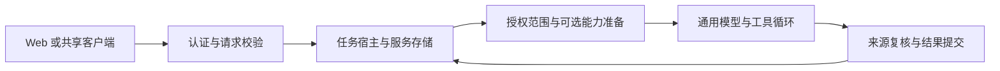

# 个人 Agent 架构

## 当前实现

Web 工作台与 CLI 通过同一认证 API 提交持久任务。RunHost 管理排队、取消、总超时、恢复和结果提交；通用执行器只处理一次模型与工具循环。执行前可准备带来源的历史摘录和表达提示。旧 QQ 路径已退出活动代码，见[归档记录](AGENT-REFACTOR-PHASE-4.md)。

## 源码职责

| 目录 | 职责与依赖限制 |
| --- | --- |
| src/app | 服务配置、生命周期、HTTP API、认证和本机进程管理 |
| src/agent | 中立消息、身份契约和执行器；不依赖 HTTP、数据库或渠道 |
| src/capabilities | 可选来源召回、来源过滤和人格表达；不依赖服务存储或供应商 |
| src/channels/console | 工作台提示与执行前上下文组合 |
| src/runtime/service | 持久任务、会话历史、授权列表与来源读取 |
| src/infrastructure/models | DeepSeek 协议转换及单次 HTTP 请求 |
| src/tools | 时间、骰子、搜索实现及每次执行的工具注册 |
| src/shared | 取消、并发和基础值校验 |
| src/testing | 旧存储兼容测试夹具；不进入服务运行路径 |
| legacy/qq | 旧 QQ 源码、测试、配置、素材和历史文档；默认不编译、不执行 |

宿主可以依赖具体实现；执行核心和能力只使用小型契约。`architecture.test.ts` 检查活动相对导入不引用归档，核心与能力不依赖渠道、服务存储或供应商，默认命令不暴露旧入口。

## 身份与记忆

拥有者、当前会话、发言者、参与者列表、渠道和直聊/共享类型均为显式元数据，不解释数字 ID 或 `private:` 编码。当前服务只创建拥有者直聊。共享会话的能力层检查拒绝私聊资料，成员管理和共享 API 尚未实现。

短期历史只读取同会话已完成问答。可选来源记忆复用服务消息，默认只读当前会话；跨会话列表由拥有者管理，普通设备不能修改。摘录必须存在于原用户消息中，保留来源，且在继续执行和最终提交前检查版本及原文。

人格只接收正文及已提交历史的副本，返回表达提示；不拥有认证、记忆授权或工具注册能力。关闭或失败时继续基础助手表达。详细配置和限制见[三期记录](AGENT-REFACTOR-PHASE-3.md)。

## 任务与执行预算

宿主默认最多 3 个并发任务，每项执行总时限 120 秒。每次模型请求最长 30 秒；工具默认最多 3 轮、总共 8 次，每项等待 8 秒、结果 2000 字符。能力准备每项等待最多 2 秒。

取消会停止后续模型和工具调用。忽略取消信号的迟到结果不能写成助手消息。推理通过独立回调和存储返回，不进入下一轮模型历史。已接受任务不依赖浏览器是否在线；重启会将未完成任务标记为 interrupted，不自动重放。

## 数据与公开协议兼容

数据文件、`service-owner.json`、`bot.lock` 和原 QQ 表保持原样。活动服务只操作 `service_` 表，旧资料不导入。模式版本独立保存在 service_meta，未知版本拒绝启动。跨会话授权存在新增的 service_memory_policies 中，不另建一份短期历史。

API 的 `qq` 字段为兼容保留，固定为 disabled。项目包名暂时保留，避免引入包身份迁移。旧宿主完整快照可从 `8923f49` 在独立目录恢复，不能将旧入口重新接入活动依赖图。

## 验证与后续范围

核心与能力的假模型测试、正式 API、任务生命周期、授权隔离、存储兼容、锁安全和浏览器测试都保留在默认检查中。旧群聊行为测试随源码归档，默认测试数量因此减少；这不代表旧群聊行为仍被支持。

命令式 CLI 和工作台来源授权管理已接入共享 SDK；授权保存通过版本检查避免覆盖多设备改动。后续可按需求推进交互式聊天体验。记忆语义提取、账号绑定、共享会话和云端部署需要单独定义数据权限与验收，见[交接计划](AGENT-REFACTOR-HANDOFF.md)。
