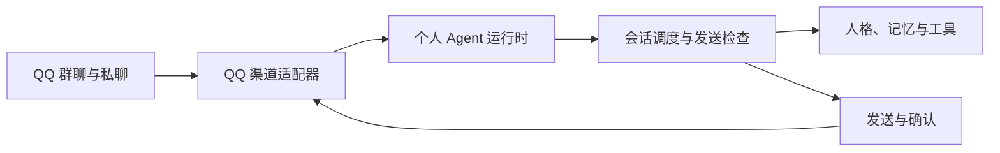

# 个人 Agent 架构

## 功能与定位

个人 Agent 是持续保存本人资料、理解当前对话并执行可用工具的助手。QQ 群聊、私聊和经过认证的工作台直聊是接入入口。常驻服务及正式 API 见[多客户端阶段 B](MULTI-CLIENT-PHASE-B.md)；CLI、Web 业务界面待下一阶段接入。共享宿主装配模型、记忆和生成额度，QQ 与工作台分别处理各自的调度和结果提交。

本文面向仓库维护者，描述现行目录与运行时边界。既有个人长期记忆继续保留来源和可见范围，群聊中的私聊资料披露规则沿用原实现。其余文档的阅读顺序见 [文档索引](README.md)。

## 源码目录

源码按职责归入五个主体目录。`app` 集中放运行入口，`shared` 只放多个领域共用的基础工具。目录使用小写，测试与被测模块放在一起。

```text
src/
├── app/                    共享启动、常驻服务、HTTP 层、实例管理与维护命令
├── channels/
│   ├── channel.ts          渠道接口与规范化引用契约
│   ├── console/            独立工作台直聊生成环境
│   └── qq/                 QQ 消息解析、连接、查询及发送适配
├── runtime/
│   ├── agent.ts            运行时装配与生命周期
│   ├── message.ts          通用消息契约
│   ├── chat-scope.ts       会话标识与旧私聊键兼容
│   ├── lock.ts             本机实例锁与安全停止
│   ├── service/            工作台持久执行、事务提交及事件恢复
│   ├── conversation/       会话编排、上下文、引用和回复准备
│   ├── participation/      窗口、参与规则与主动预算
│   └── delivery/           分段发送、队列和发送前检查
├── cognitive/
│   ├── models/             模型请求封装与文字生成
│   ├── personality/        人格规则、表达计划与提示组装
│   └── *.ts                语境观察、接续与参与判断
├── memory/
│   ├── memory.ts           短期对话策略
│   ├── store.ts            短期会话的 SQLite 存储
│   └── events/             长期证据、个人资料、摘要、召回和观察
├── tools/
│   ├── builtin.ts          时间与骰子
│   ├── search.ts           联网搜索
│   ├── vision/             图片获取校验与单图理解
│   └── memes/              表情资源、选择和状态
└── shared/                 取消、并发控制与基础值校验
```

进程和配置的组装留在 `app`，QQ 协议转换留在 `channels/qq`，会话任务的执行顺序由 `runtime` 管理。模型判断和表达放在 `cognitive`；记忆的来源、版本、可见范围及持久化放在 `memory`。

目录重组保留原 QQ 接口。常驻 HTTP 服务通过独立的 `app/service-bootstrap.ts` 装配服务配置、模型生成器与实例锁，不再初始化 QQ 资源。`app/bootstrap.ts` 仅保留为旧 QQ 入口的装配器。两者通过 `app/host-lock.ts` 共享同一数据目录的排他锁。配置仍在根目录的 `config/`，既有 SQLite 表结构和会话键保持原样；服务新增 `service_` 前缀表保存工作台记录。`pnpm test` 使用递归文件匹配，覆盖所有子目录的 `.test.ts`。

## 运行结构

下图描述 QQ 渠道内部的处理路径；常驻服务与工作台执行结构见[阶段 B 实施记录](MULTI-CLIENT-PHASE-B.md)。



| 模块 | 职责 |
| --- | --- |
| `src/runtime/agent.ts` | 装配会话、记忆和发送流程，管理启动、停止与任务取消 |
| `src/channels/channel.ts` | 定义接收、连接状态、发送确认及可选查询能力 |
| `src/channels/qq/qq-channel.ts` | 将查询能力映射为 OneBot（QQ 通信协议）的动作；区分群聊与私聊路由 |
| `src/channels/qq/napcat-transport.ts` | 管理 WebSocket 连接、重连、请求匹配和发送确认 |
| `src/channels/qq/napcat-client.ts` | 保留原调用接口，将 QQ 适配器交给个人 Agent |
| `src/app/demo.ts` | 使用进程内模拟渠道运行同一套 Agent，无需 QQ 与模型密钥 |

## 接入约定

渠道工厂在 `start()` 后才发送事件。发送成功必须以渠道确认结果为依据，且每段只报告一次确认。连接被替换后，先前捕获的发送对象必须失效，避免旧草稿在重连后发出。

`createPersonalAgent` 返回 `start`、`tick`、`stop` 和渠道连接状态 `status`，重复启动和停止均不会再次执行底层操作。停止会取消会话任务，并拒绝随后到达的消息和确认。运行时自行创建的短期记忆在停止时关闭；外部注入的记忆和事件记忆由调用者关闭。

记忆的本人标识由渠道解析后传入。当前 QQ 中相同账号在群聊和私聊具有相同本人标识，短期会话仍按窗口隔离。尚未提供不同平台账号之间的身份绑定。

## 本次边界与后续迁移

运行时装配已脱离 QQ 连接层，新增渠道可以实现相同接口复用会话流程。核心消息使用 `ChatMessage` 和 `chatId`；上下文使用 `ChatContext` 与 `ChatSnapshot`；参与判断使用 `ChatJudge`。这些模型同时用于群聊和私聊，平台字段仅在适配器中解析。

引用消息和图片历史已使用 `channel.ts` 中的统一契约：

| 契约 | 数据与约束 |
| --- | --- |
| `ReferencedMessage` | 聊天、消息和作者标识，文字与可选图片附件；标识可以是任意平台的字符串 |
| `ReferenceHistory` | 聊天标识与消息元数据；不携带附件地址或图片内容 |
| `MessageLookup` | 接收待查消息标识、取消信号和当前请求，返回规范化引用或空结果 |
| `HistoryLookup` | 接收当前请求和取消信号，返回已校验的历史或空结果 |

QQ 适配器调用 `onebot.ts` 解析和校验原始响应，确认群聊或私聊归属后才返回数据。会话层再次检查聊天、消息和作者标识；图片历史以当前请求为锚点，最多读取前面 20 条。确认看图意图后，才查询选定原消息的附件。

其他渠道应实现相同契约，无需构造 OneBot 字段。历史按时间先后排列，包含当前请求；找不到当前请求、聊天不符或消息标识重复时，不使用历史。引用处理不再导入 OneBot 模块。

### 数据兼容

SQLite 的 `group_id` 列名保持不变，会话键仍为原会话标识与本人标识组成的数组。QQ 数字群号和 `private:<账号>` 继续使用原值，无需搬迁或重新生成记忆。

历史事件、关注事项、主动观察和记忆版本的 JSON 顶层继续保存 `groupId`。存储边界读取时转换为 `chatId`，写入时恢复旧字段；业务 payload 内部字段原样保存。核心和 QQ 适配器均使用新字段，代码调用者需要传入 `chatId`。

兼容测试直接构造旧格式数据库，检查读取、修改、重启、取消、过期归档和聊天隔离。此次变更没有修改数据库版本，也不修改配置项中的群聊白名单等业务含义。

当前每个运行时绑定一个渠道。多个渠道同时接入时，仍需设计渠道命名空间、身份绑定和按渠道断连取消任务，避免不同平台的账号或会话标识碰撞。

## 验证方式

`pnpm typecheck` 检查类型；`pnpm test` 执行本地测试；`pnpm dev` 执行离线模拟。运行时专用测试覆盖群聊与私聊隔离、未确认发送不写记忆、停止后拒绝输入和断连取消生成。新增契约测试使用非数字账号和消息标识；QQ 适配器的 WebSocket 测试覆盖引用转换、图片历史去除附件地址、跨群拒绝和私聊不查群历史。原有引用和识图测试继续验证发送、取消与失败处理。

本次没有变更数据库结构，也没有连接真实 QQ 或模型提供商。真实账号与模型的端到端行为仍需单独验证。
