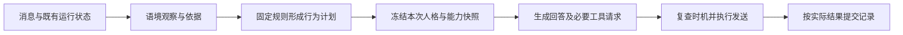

# 人格运行时与决策引擎升级评估

日期：2026-10-26。状态：设计评估，尚未实施。读者：本仓库开发与维护者。

实施进度：阶段 1 的无状态混合决策已实现，默认保留 legacy。实际接口、验证范围与顺序差异见[首版实施记录](PERSONALITY-IMPLEMENTATION.md)，真实模型对比仍待完成。

## 评估结论

现有方案适合作为单轮表达适配的起点，具备逐步演进为人格运行时的条件。建议在实施前升级数据契约与职责划分：LLM（语言模型）产出语境观察，纯函数把观察与固定人格规则转换成行为计划，运行时管理任务和未来的跨轮状态。首版仍保持无跨轮人格状态。

本次参考[运行时与决策引擎讨论](https://chatgpt.com/share/6adeb8ff-f890-83ec-b3c9-3f9423d138c4)。分享页已读取；其中指标、时限与状态变化幅度均为示例，不作为验证结论。团队记忆工具本次未提供，现状判断依据为本仓库源码。

相比上一版，优先升级接口边界，不立即增加情绪和关系参数。没有消费者、没有处理规则、没有验收方法的数值字段暂不加入。

## 当前基础与升级空间

| 能力 | 仓库现状 | 升级判断 |
|---|---|---|
| 语境理解 | `group-judge.ts` 判断主动参与，`follow-up.ts` 判断接续；生成模型再次阅读上下文 | 有基础，但不同判断的输出不能直接当成统一语境观察 |
| 决策与执行 | `conversation.ts` 管理优先级、窗口、预算、取消、版本和发送前复查 | 已有决策引擎的部分能力；逐步提取可测试规则，保留现有编排 |
| 运行时 | `Conversation`、`GroupContext`、`ObservationWindows` 管理短期运行状态 | 已有状态宿主，不需要另外创建平行的机器人主循环 |
| 人格表达 | 固定角色卡及运行说明，上一版拟增加表达分类 | 可以通过独立语境契约和纯函数策略演进，避免分类器直接控制模块与状态 |
| 状态保存 | SQLite 仅保存个人对话；群讨论在内存；表情频率另存 | 不具备人格状态事务，不能把新增 JSON 建议直接写入现有会话表 |
| 回放 | `replay.ts` 使用固定判断模拟调度 | 可扩展为“同一观察、状态和时间，重算同一计划”；现有回放不证明模型判断质量 |

## 对分享讨论的取舍

| 建议 | 本项目采用方式 |
|---|---|
| LLM 理解、代码约束 | 立即纳入职责设计；字段合法不等于语义正确，必须保留 unknown 与证据不足路径 |
| 观察、状态建议、行为建议分开 | 立即分开概念；首版只实现观察与行为计划，不预留可直接执行的任意状态补丁 |
| 8～12 个指标 | 暂不照搬数量。先保留意图、明确限制、依据和不确定性，后续按功能逐项增加 |
| 熟悉度、敌意、情绪分数 | 不作为客观指标。熟悉度优先来自明确偏好和历史证据；暂不让一句话决定关系 |
| 人格影响参与意愿 | 后续只影响主动插话和暖场的软偏好，不覆盖明确呼叫、暂停结束、预算和权限 |
| 消息事件聚合 | 复用现有碎句合并和快照；话题事件需额外验证归属，不能按固定时间窗口混合多人话题 |
| 分析与生成合成一次 | 暂不采用。现有生成包含多轮工具调用，合并会改变输出协议；先复用已有判断阶段的分析结果 |
| 快慢两种时间尺度 | 适合后续关系与兴趣记忆；慢速处理只产建议，不能自动改核心身份或在线修改规则 |

## 建议的职责结构



这是职责结构，不要求增加七个服务或七次模型请求。现有参与判断仍有自己的调用时机；表达观察可以与同一任务的已有判断一起返回。明确呼叫跳过参与判断时，才按需要运行独立观察器。

运行时拥有标识符、版本、取消和提交；模型只接触匿名数据。决策函数不发网络请求、不写数据库，时间和随机值通过入参提供。这样可以区分观察错误、策略错误、生成偏离与执行失败。

## 首版契约的修订

上一版的 `ExpressionDecision` 可以保留为最终表达视图，但不再直接作为模型输出。模型返回观察，程序形成计划；模型提出的“接梗”不自动等于允许正常强度的调侃。

```ts
type InteractionIntent =
  | 'question' | 'casual' | 'play' | 'support' | 'unknown';

interface ContextObservation {
  intent: InteractionIntent;
  seriousness: 'explicit' | 'inferred' | 'unknown';
  requestedBanter: 'stop' | 'allow' | 'unspecified';
  evidenceRefs: readonly string[];
}

// 以下字段由本地代码绑定，模型不能指定其任务归属。
interface ObservationReceipt {
  taskId: string;
  inputRevision: string;
  analyzerVersion: string;
  status: 'valid' | 'unknown' | 'unavailable';
  observation?: ContextObservation;
}

interface ExpressionPlan {
  mode: 'neutral' | 'explain' | 'casual' | 'play' | 'support';
  banter: 'off' | 'light' | 'normal';
  automaticMeme: 'eligible' | 'suppress';
  reasonCode: string;
  policyVersion: string;
}
```

`inputRevision` 应绑定规范化后的当前请求、目标、触发消息、历史版本与实际分析快照，不能只用群消息数量。证据指针只允许指向当前已提供资料；若需要引用个人历史，应提供类似 `history-1` 的独立引用，不能要求模型编造群消息依据。

模型输出中的 explicit 仍是语义判断，不是真实性证明。首版保留完整当前请求与核心角色规则供生成器读取，避免表达计划屏蔽用户要求。暂不增加模型自报 confidence；后续若使用，应先用标注样本校准，不直接当正确概率或发送概率。

计划中的 `automaticMeme=eligible` 只表示允许进入现有选图流程，不能绕过频率、候选语义与发送复查。明确请求图片与自动配图分开处理。

## 请求复用与失败边界

1. 对主动参与和接续路径，在原判断结果旁增加可选观察字段；原参与结果与观察分别校验。参与结果有效而观察无效时继续原流程，表达回到 neutral。不能因附加字段坏了就改变原本可用的参与结果。
2. 仅复用同一任务、同一输入版本、同一分析器版本的观察。`GroupJudgment` 当前没有上述表达字段，不能只把 reason 或 topicKey 当作观察。接续路径同样需要显式扩展。
3. 已有判断提供有效观察时不再调用独立观察器。若支持观察扩展的判断已经失败或返回 unknown，本轮直接 neutral，不追加重试；旧判断器未提供该能力时，可由配置启用独立观察器。
4. 明确呼叫可以进行一次独立观察；空 @、固定命令和暖场按上一版本地规则处理。独立观察仍沿用任务取消，超时后继续原卡规则。3 秒上限继续作为待测配置，不作完成时间承诺。
5. 工具调用、短句改写不重复分析。发送前复查只判断当前草稿能否继续发送，不提交人格变化；话题或用户意图改变使旧草稿不合适时放弃，不给旧草稿偷偷换一份人格计划。

复用观察可能减少额外请求，但扩展参与判断输出也可能增加时延和格式失败率。必须分别比较“原判断 + 独立观察”与“扩展判断”的成本、质量和取消表现，不能只按请求次数判断优劣。

## 文件与接口调整

| 拟议文件或接口 | 职责 |
|---|---|
| `context-analysis.ts`（新增） | 观察结构、模型响应解析、证据校验、独立分析器 |
| `personality-policy.ts`（新增） | 纯函数 `resolveExpression(input)`，从观察与固定规则形成计划；模块互斥及优先级在这里处理 |
| `personality-runtime.ts`（按需要新增） | 首版只绑定任务、版本及不可变计划；后续承接状态读取、衰减与提交，不拥有 QQ 调度主循环 |
| `group-judge.ts`、`follow-up.ts` | 可选返回观察；保留参与判断各自的语义与失败策略 |
| `conversation.ts` | 编排观察与计划，向文字、识图和媒体路径传递同一份只读计划；沿用现有并发名额和取消机制 |
| `deepseek.ts`、`vision.ts` | 接收可选的冻结计划并构建提示，不写任务元数据；旧入口通过适配器保持可用 |
| `persona.ts` | 从本地可信模块和计划构建提示，不处理关系更新或发送判断 |
| `memes.ts` | 读取配图限制，继续执行现有选图与语义复核 |

这修订了上一版“生成器写入可变任务容器”的建议：本轮计划由编排层在生成前形成，通过可选参数传入各适配器。生成函数仍可返回字符串，未来需要携带执行记录时，再用明确的返回类型统一升级。

图片关联解析目前在 `Conversation` 的明确呼叫流程中完成。观察应在确定实际任务后运行；当前请求、上下文和所选图片路径必须属于同一任务。首版文字观察不能读取图片，因此原图内容与文字计划冲突时，识图生成优先满足真实图片任务；若评估显示误判，应先改为该路径的保守计划，再考虑图像分析模型。

## 状态演进的关键约束

后续状态必须区分两类事件，修正上一版“所有状态都等发送成功再更新”的笼统规则：

| 状态或事件 | 正确处理 |
|---|---|
| 外部输入的观察状态 | 可在不回复时记录短期候选，例如当前话题发生变化；按消息去重和输入版本约束，不依赖发送成功 |
| 本轮计划 | 任务局部数据，生成前冻结；取消后废弃，不自动形成长期事实 |
| 参与次数、已说过的梗等行动状态 | 依据实际发送确认更新；不得把草稿当已说过 |
| 长期关系与偏好 | 通过独立、可撤销的证据策略提交；用户明确要求停止调侃即使未成功回复，也应影响后续计划 |
| 模拟情绪 | 只有确实需要该功能时再加入；分别定义外部事件和自身行动对状态的影响，避免同一事件在判断与发送时重复累加 |

未来可采用 `preview(state, observation, now) -> plan` 与 `reduce(state, event) -> nextState` 两类纯函数。事件类型明确区分“已接收输入”“已确认送达”“偏好已撤销”，各有去重键和版本检查。读取时的时间衰减不代表一次新的互动。

发送成功后数据库写入失败仍可能发生。进程内去重或 SQLite 单次事务不能保证远端发送与本地状态原子完成；若以后需要跨重启恢复，必须单独设计操作记录与恢复策略。当前 NapCat 未确认发送不自动重试的规则继续保留。

## 迭代顺序与进入条件

| 阶段 | 交付与验证 | 进入下一阶段的条件 |
|---|---|---|
| 1：无状态混合决策 | 可信模块、观察契约、纯函数计划、可选分析复用、旧模式回退 | 相同匿名样本比原卡有明确改善；原参与、工具、识图和发送检查通过；额外时延可接受 |
| 2：短期连续性 | 话题与互动模式记录、时间衰减、失效与清空、事件去重 | 多轮转换更自然，取消和并发回放不串状态；不能只证明持久化成功 |
| 3：偏好与关系记忆 | 明确偏好、共同经历来源、撤销、有效期和跨群隔离 | 记忆准确且可修正，停止调侃立即生效，不自动增加冒犯许可 |
| 4：人格影响主动参与 | 在既有预算内按兴趣等偏好选择候选 | 相比原参与判断减少多余插话；明确呼叫质量无回退 |

暂不安排“自动人格进化”阶段。只有已有观测能说明哪些变化有益，且可以撤销与回放时，才评估慢速兴趣更新；不允许模型在线修改核心人格文件。

## 验证补充

除上一版场景表外，增加同一语句在不同上下文中的解释、证据不足时返回 unknown、错误观察不绕过权限、观察复用版本不符、观察字段损坏不破坏参与结果等测试。加入“停止调侃但本轮发送失败”的未来状态测试，避免把用户偏好绑定到送达成功。

日志分开记录观察来源与状态、计划原因码、策略版本、生成耗时、复查结果、实际送达和提交结果。默认不记录原文、真实账号或完整关系内容；合成回放可以保存完整观察与状态。若要重放线上案例，需要另行定义受控采样，不能声称仅靠原因码就能完整复现。

本次只完成设计评估和文档修订建议，未修改运行代码或模型配置，未进行模型对比测试。已核对源码依据、标题、用词、段落和标识符；效果与成本结论需在实施后验证。
