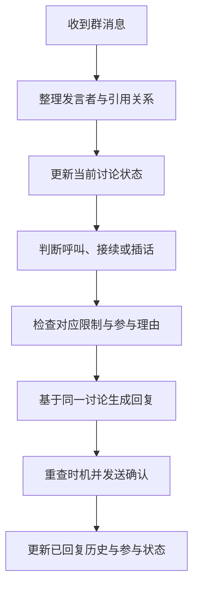

# QQ 群友机器人设计说明

本项目继续以 qq-ai-companion（TS bot）为开发主线，目标是让机器人理解正在发生的讨论，分清对话对象，并在适当时机说一句有用、有个性的话。AstrBot v0.1.1 暂停运行，保留配置、数据和版本，作为功能参考。

本文面向后续开发与验收。配置快照采集于 2026-10-23；“现状”来自当时的本机配置和代码，“目标”是当时尚未落地的行为，两者分开记录。产品原则仍可参考。阶段是否完成、暖场默认值和进程入口以 [文档索引](README.md) 指向的架构、短期大纲和 README 为准。

## 1. 产品定位与行为原则

- 群友身份：保持大肥鱼／小鲸鱼角色的短句、幽默和个性；具体人格由可替换角色卡定义。
- 对话理解：看清谁在对谁说话、当前话题及前后回应关系，避免只对最后一句做反应。
- 连续交流：正在跟机器人聊天的人继续追问时，不应因为插话冷却而突然失联。
- 克制参与：普通群聊默认旁听，兴趣相关、确有补充或被邀请时才考虑插话。
- 能力诚实：没有搜索、图片或发送工具时，不声称已经查询、看图或发图。
- 有效反馈：失败、过时、被取消的生成不发送；只有确认送达的内容进入已回复历史。

“被叫到”“接着聊”“主动插话”“暖场”是四种不同的参与方式，分别维护状态与限制。人格决定表达方式，参与策略决定此刻是否开口，工具决定能完成什么操作。

## 2. AstrBot 配置快照及取舍

以下是暂停前的实际配置，不是要求 TS bot 原样复制的参数表。运行时配置不随源码标签保存，因此部分值已经不同于早期 README。

| 主题 | 暂停前实际状态 | 对 TS bot 的启发 |
|---|---|---|
| 人格 | 默认 dafeiyu，保留 legacy 角色卡 | 支持角色卡版本及统一昵称；不直接覆盖旧角色卡 |
| 模型 | 当前选择 deepseek-flash-thinking；另有 chat、pro 档位 | 判断与生成分别配置，默认先用成本低、延迟短的模式验证 |
| 工具调用 | 支持思考内容回传，最多由框架调度工具循环 | 若引入思考模式，必须验证多轮工具历史兼容性 |
| 搜索 | DeepSeek 搜索启用，不在普通 QQ 回复中展示引用标记 | 保留内部来源，回答可核查；避免裸标签出现在正文 |
| 群上下文 | 群历史与上下文注入开启，判断最多 60 条消息 | 保留发言者、时间和引用关系，并控制长度 |
| 图片 | Flash 提供商声明图片能力；群历史图片转文字关闭 | 能力由实际调用验证；先处理用户明确要求理解的图片 |
| 判断 | 首轮概率 1.0，回复后概率 0.25；决策推理开 | 避免随机截断正常接续，记录每一次沉默的原因 |
| 注意力／疲劳 | 两套总开关均关闭 | 无须照搬大量未启用的权重和参数 |
| 合并碎句 | 等待 3 秒，最多额外合并 3 条消息 | 保留消息各自发送者和顺序，不能合成一个人的话 |
| 限频 | 最多 5 分钟 4 次回复 | 按参与类型分别限制；正常追问不占主动插话预算 |
| 暖场 | 开启，静默阈值 20 分钟，概率 25%，23:00–07:00 安静 | 放到后期，要求具体话题、近期有人活动和独立预算 |
| 表情包 | 蓝色大肥鱼包默认，贴吧包备用；每条最多 1 张 | 本地分类选图，文本优先，发送结果要可确认 |
| 配图频率 | 提示词约束每 8–10 条回复 1 次，避免连续发图；旧路径概率 30% | 在代码中记录实际发送次数，不能只靠提示词约束频率 |
| 表情附加能力 | 语义检索、自动收集、额外情绪模型关闭 | 首版按分类和简单规则选图，无须引入额外模型与向量库 |
| 私聊 | 群聊插件不处理私聊，由 AstrBot 核心处理 | 快照当时 TS bot 以群聊为主。私聊后来以 `private:<账号>` 接入同一运行时，见个人 Agent 架构 |
| 运维 | 两个本机面板、固定基础镜像、源码包与运行数据分开 | 保留明确的启动、停止、健康检查与数据备份入口 |

### 当前体验问题的来源

插件内置判断倾向“积极参与”，额外规则却要求“默认潜水”“不确定就不回”；额外规则内部也同时允许兴趣插话、禁止未指向机器人的他人讨论。模型需要处理相互竞争的指令，行为不容易稳定。

“同一话题只主动说一次”等要求主要写在提示词里，缺少可靠的话题状态。回复后概率和密度限制又可能阻断已经开始的对话。TS bot 应把这些要求变成可观察的状态转换与独立预算。

## 3. 改造前的 TS bot 基础与差距

| 范围 | 已有能力 | 待补内容 |
|---|---|---|
| 参与模式 | 明确呼叫、用户接续窗口、每句判断、随机插话、暖场 | 将接续和主动插话同时运行，统一优先级 |
| 当前实际模式 | always；自动回复冷却 45 秒，每小时 12 次 | 不再让统一冷却阻断正常接续 |
| 用户接续 | continue／pause／end／uncertain 四种判断；窗口独立 | 当前 always 模式不走这条接续路径，需要组合调度 |
| 群上下文 | 默认最近 12 条、5 分钟；按文本拼接 | 加入发言者、消息标识、时间、引用关系和机器人自身发言 |
| 生成输入 | 每句判断会读取群近期文本和用户历史 | 该模式最终生成主要只接收当前输入与个人历史；判断与生成应使用同一份群上下文 |
| 个人记忆 | 按群和用户隔离，最多 9 轮，30 分钟过期，SQLite 保存 | 与群讨论记录分开；不把别人的发言归到当前用户记忆 |
| 回复执行 | 分段最多 3 条、间隔发送、确认送达、取消旧任务 | 群讨论推进后重新检查插话是否仍适合发送 |
| 工具 | 查时间、掷骰子；主要在明确呼叫时使用 | 搜索、图片理解、本地表情包 |
| 资源控制 | 当前最大 3 个生成任务；支持任务等待及连接重试 | 判断、生成与工具开销分别统计并限制 |
| 自动测试 | 接话、引用、取消、记忆、分段和发送确认等 54 项测试 | 补充真实群聊结构的合成场景和参与决策回放 |

该表记录 A–C 改造前状态。统一上下文、分离接续与插话、发送前复查见 [A–C 实施记录](AC-IMPLEMENTATION.md)。表中 9–23 点、每轮概率 50% 是改造前旧项目的暖场，不是当前默认值；当前默认见 [短期目标大纲](SHORT-TERM-PLAN.md) 第 6 节。

## 4. 目标消息处理流程

### 4.1 输入与讨论记录

每条消息至少保存群、发送者、消息标识、时间、正文、提及对象、被引用消息及消息类型。内部使用真实标识区分参与者，日志和回放对外展示时使用匿名代号。

最近讨论既包含人类消息，也包含机器人实际发送成功的消息。图片先记为图片消息及可用说明，不能用不存在的识别结果填充上下文。按时间、条数和 token 数共同裁剪；token 是模型处理文本长度的计量单位。

### 4.2 参与判断优先级

| 类型 | 典型触发 | 限制与退出 |
|---|---|---|
| 明确呼叫 | @机器人、有效昵称呼叫、确认引用机器人 | 不受主动插话冷却影响；命令、权限和并发仍受控制 |
| 对话接续 | 刚与机器人交流的人回答、补充、追问 | pause 保持关系但不回，end 结束关系，uncertain 继续旁听 |
| 主动插话 | 新话题与角色相关，且能提供尚未出现的信息 | 限频、重复检查、对话对象和时机检查；不确定就跳过 |
| 暖场 | 适当时间、有人近期活跃、有具体话题、空闲足够久 | 独立开关与预算，默认最后启用 |

一个消息只进入一条主要回复路径。明确引用其他人的消息不能仅因“有引用”而唤醒；引用无法解析时，按普通上下文判断，不自动假定被引用者是机器人。

### 4.3 最小状态与决策结果

首版维护正在交流的用户、最近参与话题、最后一次插话、是否有人回应机器人、当前任务及消息版本。话题可先用近期消息和轻量判断识别，不以引入向量数据库为前提。

判断器输出结构化结果：参与类型、回应对象、是否回复、简短原因、依据消息和话题是否延续。只记录可用于排障的理由，不要求模型公开完整思考过程。

“每条都判断”应表示每条有效消息被调度器处理，不等于每条都请求模型。明确命令、明显无内容、重复事件及不可参与对象可先在本地处理；语义不清时才请求判断器。

### 4.4 生成与发送

判断器与生成器使用同一版本的近期讨论，生成输入明确标识当前回应对象、参与类型和可用能力。角色卡只约束身份、语言和表达习惯，避免重复加入相反的参与规则。

发送前检查：是否已经有人回答、话题是否转移、用户是否要求暂停、原请求是否被新请求替代。只有使当前回复失效的新消息才取消任务，不能因为无关群友发言就一律取消。

失败或取消不写入成功历史，也不扣除“成功参与”次数；模型调用成本仍应单独记录。部分分段送达时只记录实际送达部分，未确认的消息不自动重发。

## 5. 工具、图片和表情包

### 联网搜索

保留查时间、掷骰子，增加有超时、条数上限和来源记录的搜索工具。涉及新近事实、版本、天气或用户明确要求查证时使用；没有可用工具或搜索失败时说明限制。

搜索结果属于外部资料，不能改变系统规则。内部保留来源标题与 URL；普通群聊无需展示裸引用标签，用户要求依据时可给正常链接。先做明确请求，再评估自动插话调用搜索的成本。

### 图片理解

先支持用户明确指向的一张图片：当前图片或可追溯引用图片。区分看到了图片、只看到了文件名、只有别人描述三种情况；不具备可读图片数据时不编造内容。

模型的图片支持按真实请求验证，不直接把旧配置中的模型能力声明当作长期事实。首版关闭全群自动识图，限制大小、数量和临时文件寿命。

### 表情包发送

复用新项目现有表情包资源与分类前，核查资源许可和目标文件可用性；不把 463 MB 资源直接放进源码包。首版只需分类选图和本地文件发送。

每条最多 1 张，避免连续两条都配图。每 8–10 条一次仅作为初始调参参考，以实际上下文和用户请求为准；用户要求纯文字时不配图。分类标记由程序解析后移除，发送失败可保留已成功的文字回复。

## 6. 配置、数据与运维

- 配置分为身份、模型、参与策略、上下文、工具、发送和运维几组。新参数应有默认值、适用路径和校验；删除不生效或重复含义的开关。
- 2026-10-23 的运行记录是旧项目一个 NapCat 加一个 TS 进程。同一个 QQ 账号仍然不能在两套 NapCat 同时登录。当前 Node 进程入口见 README：`pnpm bot:status`、`pnpm bot:stop`、`pnpm bot:start`。
- 源码导出不包含 .env、会话库、登录态、附件和运行日志。私人备份采用独立命令，并保证 SQLite 备份一致性。这一备份命令尚未提供。
- 健康检查的目标仍是分别报告进程、WebSocket、QQ 在线和模型可用性。进程锁状态已有入口；后三项尚未分别检查。仅面板返回 HTTP 200 不能证明机器人可回复。
- 记录参与类型、理由、取消原因、调用耗时、token 用量和送达结果；默认不保存完整群消息正文或密钥到公开日志。
- 角色卡和策略版本随源码记录；运行配置、资源文件和数据备份独立管理，版本标签不能替代运行数据备份。

## 7. 验证与效果评价

先建立匿名合成的固定场景，区分确定的调度逻辑与模型判断。确定逻辑用固定判断结果测试；语义判断用固定场景反复评估，不把一次模型输出当作稳定能力证明。

至少覆盖：明确呼叫、回答机器人、别人之间交流、对话暂停、结束、多人穿插、话题切换、已有回答、引用他人、引用丢失、碎句、重复事件、生成期间新消息、工具失败、部分送达及重连。

评价同时看误插话、漏接追问、答非所问、重复回复、延迟与成本。先保证明确呼叫和连续交流，再调整主动插话数量；不要把“更频繁回复”作为“更自然”的替代指标。

## 8. 取证来源

| 内容 | 本机来源 |
|---|---|
| AstrBot 模型、搜索、人格、群历史 | astrbot-qqbot/data/astrbot/cmd_config.json，仅提取非敏感字段 |
| 群聊判断、限频、暖场、等待窗口 | astrbot-qqbot/data/astrbot/config/astrbot_plugin_group_chat_plus_config.json |
| 判断提示词与概率分支 | 群聊插件 utils/decision_ai.py、main.py |
| 表情包策略 | AstrBot meme_manager 配置的 generation、semantic、auto_collect |
| TS 调度与上下文 | qq-ai-companion/src/conversation.ts |
| TS 判断、接续、记忆、发送 | 取证时为 src/group-judge.ts；该文件现为 src/chat-judge.ts。其余为 follow-up.ts、observation.ts、memory.ts、delivery.ts、napcat-client.ts |
| TS 模型和工具 | src/deepseek.ts、tools.ts、persona.ts |

团队记忆工具在本会话不可用，本文依据本机实际配置与代码。未抄录凭证、用户账号或真实群聊内容。
